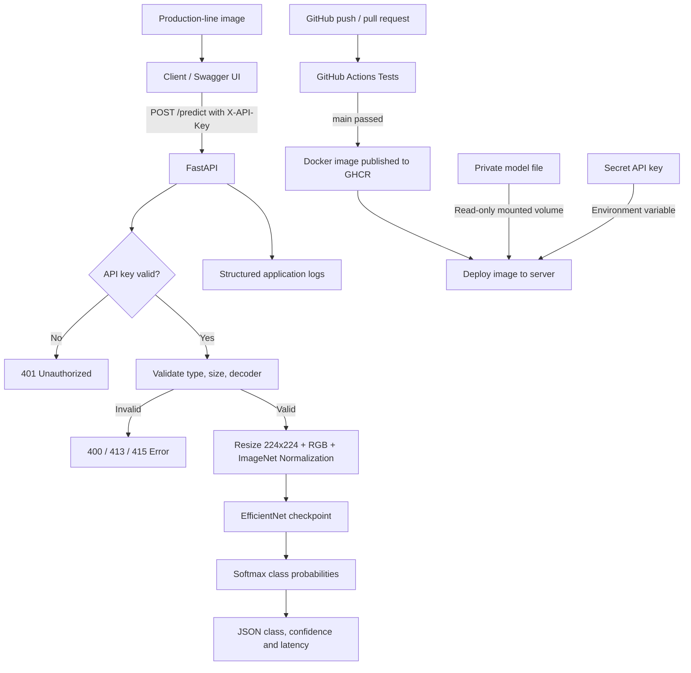

# Casting Surface Defect Detection API

A production-oriented FastAPI service for classifying casting surface defects from images using an EfficientNet-based deep learning model. This project is designed for manufacturing quality inspection workflows, where images are submitted to an API, validated, processed, and classified as defective or normal.

## Overview

This repository contains:

- A secure FastAPI inference service
- API-key protected prediction endpoint
- Image validation and preprocessing pipeline
- Docker support for deployment
- Example client script for sending requests to the model API
- CI/CD-ready project structure for testing and publishing containers

The system is intended for use in industrial inspection pipelines where reliable image-based defect detection is required.

## Architecture



## Model Contract

The service expects a model artifact exported from the training notebook and loaded from `models/final_model.pt` by default.

- Model architecture: EfficientNet-B3
- Input: RGB image resized to 224x224
- Normalization: ImageNet statistics
- Output: prediction class, confidence score, and probabilities
- Default model path: `models/final_model.pt`
- Default runtime device: `cpu`

The code validates that the API key is present and strong enough, and it enforces image validation before inference.

## Repository Structure

```text
.
├── app/
│   ├── __init__.py
│   ├── main.py
│   └── predictor.py
├── models/
│   └── final_model.pt      # model checkpoint (must be added by the user)
├── tests/
│   ├── test_api.py
│   └── test_predictor.py
├── .env.example
├── .dockerignore
├── .gitignore
├── architecture.md
├── client_example.py
├── Dockerfile
├── pytest.ini
├── requirements.txt
├── requirements-dev.txt
├── README.md
└── defective-parts-detection.ipynb
```

## Prerequisites

- Python 3.10 or newer
- pip
- Docker (optional, if running in a container)
- A trained model checkpoint exported to `models/final_model.pt`

## Quick Start

### 1. Clone the project

```bash
git clone https://github.com/yasirrHanif/casting-surface-detect.git
cd casting-surface-detect
```

### 2. Create a virtual environment

```bash
python -m venv .venv
source .venv/bin/activate
# On Windows PowerShell:
# .\.venv\Scripts\Activate.ps1
```

### 3. Install dependencies

```bash
pip install --upgrade pip
pip install -r requirements.txt
```

### 4. Configure environment variables

The API requires a strong API key and a valid model path. Use the sample file as a template:

```bash
cp .env.example .env
```

Then edit the value for `APP_API_KEY` and ensure your model path is correct.

Example:

```env
APP_API_KEY=REPLACE_WITH_A_STRONG_RANDOM_SECRET_AT_LEAST_24_CHARS
MODEL_PATH=models/final_model.pt
MODEL_DEVICE=cpu
LOG_LEVEL=INFO
```

Generate a secure API key:

```bash
python -c "import secrets; print(secrets.token_urlsafe(32))"
```

### 5. Run the API locally

```bash
export APP_API_KEY="PASTE_YOUR_GENERATED_SECRET_HERE"
export MODEL_PATH="models/final_model.pt"
uvicorn app.main:app --host 127.0.0.1 --port 8000
```

On Windows PowerShell:

```powershell
$env:APP_API_KEY="PASTE_YOUR_GENERATED_SECRET_HERE"
$env:MODEL_PATH="models/final_model.pt"
uvicorn app.main:app --host 127.0.0.1 --port 8000
```

The service is available at:

- Swagger UI: http://127.0.0.1:8000/docs
- ReDoc: http://127.0.0.1:8000/redoc
- Health check: http://127.0.0.1:8000/health
- Readiness: http://127.0.0.1:8000/ready

## API Usage

### Authentication

All prediction requests must include the `X-API-Key` header.

### Health Endpoint

```bash
curl http://127.0.0.1:8000/health
```

Example response:

```json
{"status": "ok"}
```

### Prediction Endpoint

```bash
curl -X POST "http://127.0.0.1:8000/predict" \
  -H "X-API-Key: YOUR_SECRET_HERE" \
  -F "file=@sample_casting.jpg;type=image/jpeg"
```

Example response:

```json
{
  "predicted_class": "defective",
  "confidence_score": 0.987,
  "probabilities": {
    "defective": 0.987,
    "normal": 0.013
  },
  "inference_time_ms": 85.4
}
```

### Python Example

```python
import requests

API_URL = "http://127.0.0.1:8000/predict"
API_KEY = "YOUR_SECRET_HERE"

with open("sample_casting.jpg", "rb") as f:
    response = requests.post(
        API_URL,
        headers={"X-API-Key": API_KEY},
        files={"file": ("sample_casting.jpg", f, "image/jpeg")},
        timeout=60,
    )

response.raise_for_status()
print(response.json())
```

### Using the Included Client Script

The repository includes a ready-to-use example client:

```bash
export APP_API_KEY="YOUR_SECRET_HERE"
python client_example.py path/to/image.jpg
```

The script sends the image to the default local API address:

```text
http://127.0.0.1:8000/predict
```

### JavaScript Example

```javascript
const axios = require('axios');
const fs = require('fs');

const formData = new FormData();
formData.append('file', fs.createReadStream('sample_casting.jpg'));

axios.post('http://127.0.0.1:8000/predict', formData, {
  headers: {
    'X-API-Key': 'YOUR_SECRET_HERE',
    ...formData.getHeaders()
  }
}).then((response) => {
  console.log(response.data);
}).catch((error) => {
  console.error(error.response?.data || error.message);
});
```

## Supported Image Types

The API accepts these image formats:

- JPEG
- PNG
- WEBP

Files larger than 10 MB are rejected. Corrupt or invalid images are rejected with a 400 error.

## Docker Deployment

### Build the image

```bash
docker build -t casting-surface-detect .
```

### Run the container

```bash
docker run --rm -p 8000:8000 \
  -e APP_API_KEY='PASTE_YOUR_SECRET_HERE' \
  -e MODEL_PATH='/app/models/final_model.pt' \
  -v "$(pwd)/models:/app/models:ro" \
  casting-surface-detect
```

On Windows PowerShell:

```powershell
docker run --rm -p 8000:8000 `
  -e APP_API_KEY="PASTE_YOUR_SECRET_HERE" `
  -e MODEL_PATH="/app/models/final_model.pt" `
  -v "${PWD}/models:/app/models:ro" `
  casting-surface-detect
```

## Model Requirements

Before running the API, make sure a valid checkpoint is stored in the `models` directory.

Example:

```text
models/
├── final_model.pt
└── class_labels.json   # optional if your pipeline needs explicit labels
```

If the model is not available, the app will fail at startup or during inference.

## Testing

Install dev dependencies:

```bash
pip install -r requirements-dev.txt
```

Run tests:

```bash
pytest -q
```

You can also run lint checks:

```bash
ruff check app tests --select E4,E7,E9,F
```

## Security Notes

- Do not commit real API keys to GitHub.
- Store secrets in environment variables or secure secret managers.
- Use a strong random key (24+ characters recommended).
- Use HTTPS in production deployments.
- Keep the model file in a private volume or secure artifact storage.

## Production Considerations

For production deployment, consider the following:

- TLS termination through a reverse proxy or load balancer
- Rate limiting to guard against abuse
- Metrics and monitoring for inference latency and error rates
- Secret rotation policies for API keys
- Model version tracking and reproducibility
- Separate staging and production environments

## Contributing

1. Fork the repository
2. Create a feature branch
3. Commit your changes
4. Push to your fork
5. Open a pull request

## License

This project does not currently declare a specific license in the repository metadata. If you plan to distribute it publicly, add an appropriate open-source license before release.

## Support

For questions or feature requests, open an issue in the GitHub repository or contact the repository maintainer.

## Summary

This repository provides a secure, production-oriented image classification API for detecting defects on casting surfaces. It is suitable for implementation in industrial quality control workflows, machine vision systems, and deployment via Docker or cloud infrastructure.

Use the API by generating an API key, placing the trained model in `models/final_model.pt`, launching the FastAPI service, and sending multipart image requests to `/predict` with the `X-API-Key` header.
